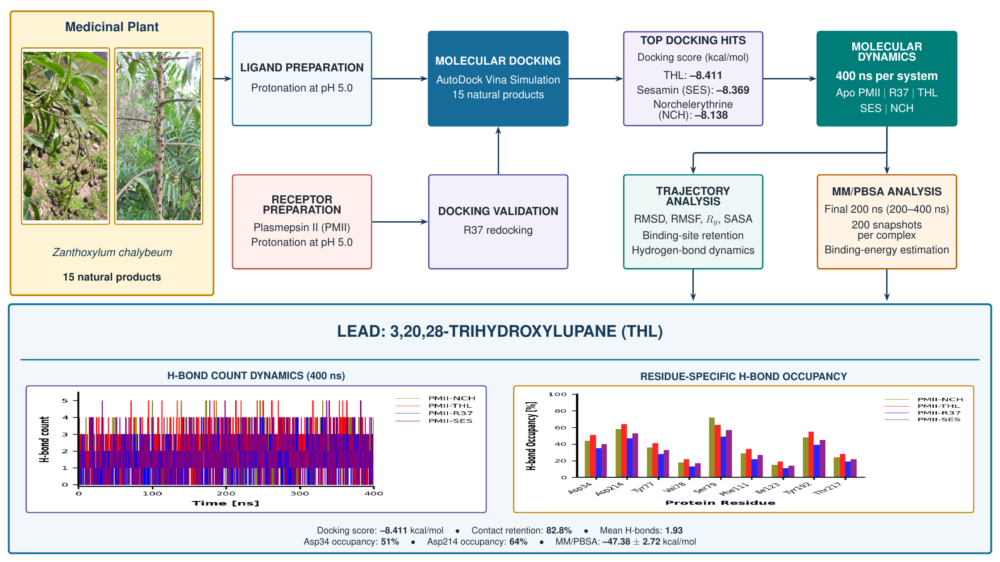

# Graphical Abstract — Plasmepsin II Natural-Product Screening

16:9 graphical abstract for the manuscript **Computational Investigation of Zanthoxylum chalybeum Natural Products Against Plasmepsin II for the Identification of Potential Antimalarial Inhibitors**.



## Files

- [graphical_abstract.pdf](graphical_abstract.pdf) — compiled, single-page vector PDF with embedded photographs and plots.
- [main.tex](main.tex) — editable TikZ/LaTeX source, with GraphPad Prism–inspired color palette and typography.
- `assets/botanical_fruits.jpg` and `botanical_stem.jpg` — source photographs.
- `assets/hbond_count.png` — 400 ns hydrogen-bond count dynamics for four complexes.
- `assets/hbond_occupancy.png` — residue-level hydrogen-bond occupancy comparison.

## Compile

Upload this repository to Overleaf, keep **main.tex** as the main document, and compile with **pdfLaTeX**. For local use:

```bash
pdflatex main.tex
```

The LaTeX source expects all four images in the `assets/` folder, as provided. The figure is a 16 × 9 inch canvas, without an external title or caption.

## Scientific context

The schematic presents a *Zanthoxylum chalybeum* natural-product docking workflow against Plasmepsin II, 400 ns molecular dynamics per system, trajectory and MM/PBSA analyses, and 3,20,28-trihydroxylupane (THL) as the lead candidate. Numerical figures reflect the supplied manuscript graphics and should be cross-checked against the final manuscript before publication.

## GA Studio — PDF viewer

The Streamlit web app uses the compiled graphical abstract PDF and provides an in-app PDF viewer, direct PDF download, and a refresh button. No AI is required.

**Run locally:** Install Python 3.11+ and run `pip install -r requirements.txt` followed by `streamlit run app.py`.

**Deploy:** In Streamlit Community Cloud, create an app using this GitHub repository, the `main` branch, and `app.py` as the main file. Authorize private-repository access to deploy this repository.

**Viewing PDFs:** The repository's own `graphical_abstract.pdf` is bundled into the app, so preview and download work without an API key. To read the newest PDF directly from a private GitHub repository without waiting for redeployment, configure a read-only `GITHUB_TOKEN` in Streamlit's server-side Secrets; never put it in the app source or a viewer-facing input. The sidebar accepts another repository and PDF path when the token has access to them.
